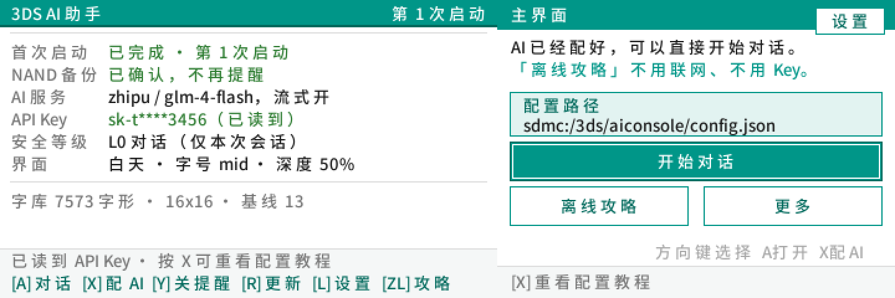
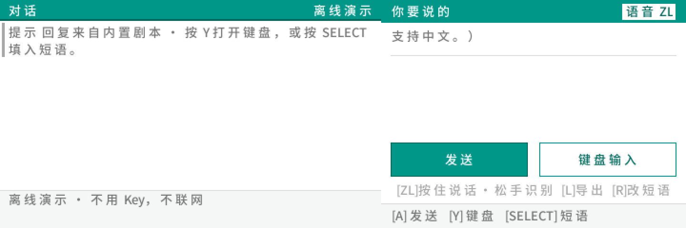
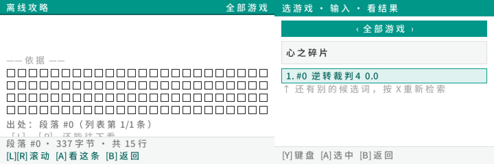
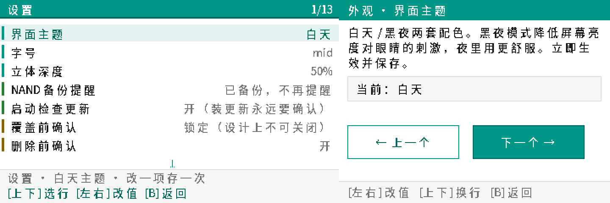

# 3DS AI Agent Tool

**语言 / Language:** [**English**](README.md) · **简体中文**

在 **New 3DS** 上跑一个**能对话、能查离线攻略、能语音说话**的 AI 助手。

不越狱系统、不改固件、不自建服务器 —— 一个 Homebrew 程序，直接连厂商的 API。
中文界面，双屏布局，全程手柄 + 触摸操作。

<!-- ─────────────────────────────────────────────────────────────
     badge 行（shields.io）。
     为什么要有：仓库页面上第一眼能读到的信息就是这些 ——
     版本、许可、平台、维护状态。没有它，访客要滚到文档里找"这软件多大、什么许可"。
     注意：版本号是**手写**在 URL 里的，发新版时要一起改（没接 CI 自动读）。
     ───────────────────────────────────────────────────────────── -->
<p align="center">
  
  
  
  
  
</p>

<p align="center">
  <b>设计 acrac</b> · <b>制作 DeepSeek V4.1-Flash</b>
</p>

<p align="center">
  <a href="https://github.com/mgeuddlyii/3ds-ai-agent-tool/releases/tag/v0.99.6">
    
  </a>
</p>

> ### ⚠️ 当前是测试版（v0.99.6）
>
> 功能已经能用，但**还在收尾**：真机的边界情况在补、插件和立体 3D 没做完。
> **正式版预计一个月后（2026 年 11 月下旬）发布。**
>
> 测试版可能改配置格式、可能有没预料到的坑。
> 遇到问题 → [**开 issue**](https://github.com/mgeuddlyii/3ds-ai-agent-tool/issues)
> 或发邮件 **dpsp2936@agent.qq.com**（[详细说明](#反馈与问题)）。

> ### 🎯 机型要求
>
> | | |
> |---|---|
> | ✅ **支持** | **New 3DS** / **New 3DS LL/XL** / **New 2DS LL/XL** |
> | ❌ **不支持** | 旧 3DS / 3DS LL / 2DS |
>
> **为什么只支持 New 系列**，三个硬原因：
>
> 1. **内存** —— 旧 3DS 只有 128 MB，New 系列 256 MB。内置的离线攻略模型
>    加知识库要占掉一大块，旧机器上余量不够。
> 2. **按键** —— 旧 3DS **没有 `ZL` / `ZR` 键**。语音输入是「按住 `ZL` 说话」，
>    离线攻略也是 `ZL` 进 —— 这两个功能在旧机器上根本没有入口。
> 3. **算力** —— 旧 3DS 是 134 MHz 双核，New 系列 268 MHz。
>    软件渲染本来就吃 CPU，旧机器上会慢到不可用。
>
> 系统要求：**Luma3DS 13+**（需要自定义固件才能跑 Homebrew）。

<p align="center">
  
</p>

---

## 它能做什么

| 功能 | 说明 |
|---|---|
| **中文对话** | 直连 DeepSeek / 智谱 / 火山方舟 / Kimi / 通义 / 豆包 / 自定义服务商，流式输出 |
| **离线攻略** | 211 款游戏、内嵌 1.18M 参数微模型 + BM25 检索，**不联网不花 Key 也能查** |
| **语音输入** | 按住 `ZL` 说话，松开自动识别上屏 |
| **多 Key 仓库** | 8 把 Key 存加密仓库，屏上随时切换，支持从 `key.txt` 导入 |
| **多任务** | 每个任务独立绑定「服务商 + 模型」，换任务等于换模型 |
| **AI 动手** | 模型可以请求执行动作（装文件、改设置…），**每一条都要你按 A 确认** |
| **内置查看器** | 能读 HTML 子集（无 JS/CSS），看攻略、看文档 |
| **从电脑取文件** | 内置 FTP 客户端，分段进度条 |
| **插件管理** | 列出 `luma/plugins/` 下的 `.3gx`，开关启停 |

<p align="center">
  <br>
  <sub>对话：上屏是记录，下屏是输入区 + 滑轨工作台</sub>
</p>

<p align="center">
  <br>
  <sub>「更多」二级菜单：不常用的入口都收在这里，6 行一屏可翻页</sub>
</p>

---

## 这东西适合你吗

先花 30 秒判断一下，省得下载完发现不是你要的。

### ✅ 大概适合

- 手上有台吃灰的 3DS，想让它干点新事
- 有 API Key，或者愿意去充几块钱（大部分服务商新号有免费额度）
- 想躺在床上、蹲在地铁上随口问一句，而不想掏手机
- 对"老掌机还能这样"这件事本身有兴趣

### ❌ 大概不适合

- **想要 ChatGPT 那种体验** —— 400×240 的屏 + 手柄打字，只适合短问短答，不适合长对话
- **完全不想弄 Key** —— 有离线演示可以点着玩，但核心的联网对话要 Key
- **期待动画很流畅** —— 软件渲染，帧率还在测（模拟器上已从 6.8fps 提到 15.7fps，真机待验）
- **想用它读长文/看网页** —— 内置查看器只支持 HTML 子集，长文在小屏上很累

> 说这些不是劝退。是**测试版最怕的不是没人用，是来错的人用了然后失望**。
> 知道边界在哪，你才知道该期待什么。

---

## 📥 下载

<p align="center">
  <a href="https://github.com/mgeuddlyii/3ds-ai-agent-tool/releases/tag/v0.99.6">
    
  </a>
  &nbsp;
  <a href="https://github.com/mgeuddlyii/3ds-ai-agent-tool/releases/download/v0.99.6/AIConsole-0.99.6.3dsx">
    
  </a>
</p>

> **一句话**：点上面那个绿色的 → 下载 `AIConsole-0.99.6-pack.zip` → 解压 →
> 把 `.3dsx` 拷到 SD 卡 `3ds/` 目录 → 插回机器 → Homebrew Launcher 启动。

### 三个文件，选一个

| 文件 | 大小 | 适合谁 |
|---|---|---|
| 🟢 **`AIConsole-0.99.6-pack.zip`** | 6.6 MB | **大多数人都选这个**。里面有下面两个 + 安装说明 + 校验工具 |
| **`AIConsole-0.99.6.3dsx`** | 5.1 MB | 只想拿程序、已经会装 Homebrew |
| **`AIConsole-0.99.6.cia`** | 3.8 MB | 想让它出现在主菜单（要用 FBI 装，需要签名补丁） |

### 直达链接

| | |
|---|---|
| 📦 完整包（推荐） | [`AIConsole-0.99.6-pack.zip`](https://github.com/mgeuddlyii/3ds-ai-agent-tool/releases/download/v0.99.6/AIConsole-0.99.6-pack.zip) |
| 🔧 仅 3dsx | [`AIConsole-0.99.6.3dsx`](https://github.com/mgeuddlyii/3ds-ai-agent-tool/releases/download/v0.99.6/AIConsole-0.99.6.3dsx) |
| 🎮 仅 cia | [`AIConsole-0.99.6.cia`](https://github.com/mgeuddlyii/3ds-ai-agent-tool/releases/download/v0.99.6/AIConsole-0.99.6.cia) |
| 📋 所有版本 | [Releases 列表](https://github.com/mgeuddlyii/3ds-ai-agent-tool/releases) |

### 包里的东西

| 文件 | 用途 |
|---|---|
| `装前必读.md` | 安装步骤、常见问题 —— **第一次装请先看这个** |
| `MANIFEST.txt` | 每个文件的 sha256，下载完可以自己校验 |
| `tools/ciainfo.py` | 查 CIA 的 Title ID，确认没和别的程序撞车 |
| `tools/smdhdump.py` | 查 SMDH 标题有没有花掉 |
| `tools/ftp_push.py` | 用 FTP 把新版本推到 3DS（不用拔卡） |

> 💡 文件名里的 `AIConsole` 是**历史命名**，程序内部的 SD 卡路径也叫这个。
> 改名只改了对外展示名，**没有动内部路径** —— 否则老用户的配置和 Key 会全部失效。

> ⚠️ 这里用 releases 列表页而不是 `releases/latest`：
> GitHub 的 `latest` 只指向**非预发布**版本，当前唯一 release 是测试版，
> 那个端点会 404。

---

## 快速开始

### 1. 装上去

**`.3dsx`（最简单）**

```
SD:/3ds/AIConsole.3dsx
```

插回 3DS → 启动 Homebrew Launcher → 选中它 → A。

**`.cia`（进主菜单）**

用 FBI 装 `AIConsole.cia`。装完主菜单会多一个图标
（桌面短名是「**AI Agent**」—— SMDH 短标题只有 8 个字符的槽位，
全名 "3DS AI Agent Tool" 有 16 个，塞不下会被静默截断）。

### 2. 配一个 API Key

三条路，挑一条：

**① 屏上直接敲**（手边没电脑时）
`主界面 → 更多 → 添加 API` → 逐项填写服务商 / 模型 / 网址 / Key → 保存

**② 从文件导入**（省打字）
在电脑上写 SD 卡里的 `SD:/3ds/aiconsole/key.txt`：

```
sk-你的key
```

也可以写完整字段：

```
provider=deepseek
model=deepseek-chat
key=sk-你的key
```

连自己的服务器：

```
provider=custom
base_url=https://your-server.example.com/v1
model=your-model-name
key=sk-你的key
```

然后 `主界面 → 更多 → 添加 API → 从文件导入`。

**③ 不用 Key**（只想看看界面）
不配任何 Key 时会自动进入「离线演示」：回复来自内置剧本，不联网。

<p align="center">
  <br>
  <sub>录入凭据屏：服务商 / 模型 / 网址 / 人设 / 上下文轮数 / Key，一屏改一项</sub>
</p>

### 3. 说话

在对话屏**按住 `ZL`** 说话，松开自动识别上屏。

语音识别中英文都走 **Groq**（`whisper-large-v3`）—— 永久免费档、不用信用卡：
20 次/分钟、2000 次/天、每天 8 小时音频。Groq 要自己的 Key，
去 [console.groq.com/keys](https://console.groq.com/keys) 免费领一个，
写进 SD 卡 `SD:/3ds/aiconsole/asr.txt`：

```
key_groq=gsk_你的Key
```

还没配 Groq Key 时会退回内置的硅基流动 Key，语音照样能用 ——
但那只是过渡方案，不是推荐路径。

---

## 操作一览

### 主界面

| 键 | 动作 |
|---|---|
| `←` `→` / 触摸 | 选格子 |
| `A` | 打开选中的格子 |
| `L` | 设置 |
| `X` | Key 管理 |
| `R` | 软件更新 |
| `ZL` | 离线攻略 |
| 右上角齿轮（触摸） | 设置 |

### 对话屏

| 键 | 动作 |
|---|---|
| `A` | 发送 |
| `Y` | 打开键盘（内置拼音输入法） |
| `SELECT` | 快捷短语 |
| `R` | 编辑短语 |
| `L` | 导出聊天记录 |
| `X` | 配置 AI / 豆包扫码 |
| `ZL`（按住） | 语音输入 |
| `←` `→` | 切换思考强度 |
| `↑` `↓` | 翻历史 |
| 底屏滑轨 | 切「聊天 / 键盘 / 项目 / 文件 / 浏览」面板 |
| `B` | 返回 |

### 设置屏

| 键 | 动作 |
|---|---|
| `↑` `↓` | 逐行移动 |
| `L` `R` | **整屏翻页**（7 行一步） |
| `A` / `→` | 改当前项 |
| `←` | 反向改 |
| `B` | 返回 |

<p align="center">
  <br>
  <sub>设置：24 行，按类别用左侧色带区分（外观 / AI / 提醒 / 安全闸门 / 诊断）</sub>
</p>

---

## 从源码构建

### 需要

- [devkitPro](https://devkitpro.org/) + `devkitARM` + `libctru` + `citro3d`
- Python 3.9+（构建脚本用）
- 环境变量 `DEVKITPRO` 指向 devkitPro 安装目录

### 一条命令

```bash
python tools/build.py
```

产物：`app/AIConsole.3dsx`、`app/AIConsole.elf`

### 打发布包

```bash
# 把产物放进 release/（make_pack.py 从这里读）
cp app/AIConsole.3dsx release/AIConsole-0.99.6.3dsx
python tools/make_pack.py
# -> dist/AIConsole-0.99.6-pack.zip（含 sha256 复核）
```

### 跑自动验收

```bash
python tools/azahar_test.py --passes "0,1,4,5,K" --wait 200 --no-png
```

需要 [Azahar](https://azahar-emu.org/) 模拟器。每趟是一个按键脚本 + 一组断言，
结果直接打印 PASS/FAIL，并把 `status.txt`、`boot.log` 留在虚拟 SD 卡里。

---

## 项目结构

```
app/
  source/
    main.c            启动流程 + 主循环（含帧耗时探针）
    gfx/              软件光栅层（双缓冲、裁剪、字形）
    ui/               19 个屏幕，一屏一个 .c
    test/             验收探针（bootlog / autorun / perfprobe）
  data/               字库、模型权重、CA 证书（编译期嵌入）
shared/               与界面无关的逻辑
  nnet/               内嵌微模型 + 知识库（离线攻略）
  chatapi.c           HTTP / 流式 SSE / 请求体拼装
  config.c            JSON 配置读写
  keystore.c          多 Key 仓库（加密落盘）
  credfile.c          key.txt 收件箱
  actions.c           AI 动作协议 + 安全闸门
plugin/translate/     Luma 3gx 插件（骨架，翻译未实现）
tools/                构建、验收、i18n、语料训练脚本
docs/                 设计文档与截图
```

### 文档怎么读

| 文件 | 给谁看 |
|---|---|
| **`CHANGELOG.md`** | **人**。每个版本改了什么、修了哪个坑 |
| **`使用手册.md`** | **人**。项目全貌、界面表、构建验收、安全分级、常量自证表 |
| `ARCHITECTURE.md` | 人。分层、帧渲染、请求链路、服务端设计 |
| `SAFETY_DESIGN.md` | 人。四道闸（模型只给数据 / 编译期白名单 / 物理确认 / 路径不来自 AI） |
| `AGENT.md` | **云端模型**。每次请求时拼进 system 消息，教它 `[[ACT:]]` 协议和红线 |

> ⚠️ `AGENT.md` 不是给人读的说明书，是 AI 的操作依据。
> 改它等于改 AI 的行为，改之前想清楚。

---

## 设计上的几个取舍

**不自建服务器。** 3DS 直连厂商 API。代价是每台机器要自己配 Key，
好处是没有任何中间人、没有运营成本、没有隐私问题。

**离线攻略用微模型而不是查 API。** 1.18M 参数跑在 3DS 的 ARM11 上，
配合 BM25 检索，211 款游戏的攻略全存在卡里。断网、没 Key、余额为 0 都能用。

**AI 要动手必须过四道闸。** 模型只能输出结构化数据（不是代码、不是路径），
动作名经过编译期白名单，最终由用户按 A 确认，路径永远不来自模型。
详见 `SAFETY_DESIGN.md`。

---

## 已知限制

- **`.3dsx` 形态没有系统说明书**，只有 `.cia` 有（3DS 的说明书是独立 content）
- **`.3gx` 插件是骨架**，翻译功能未实现
- **立体 3D 未做**，当前是 2D 后端
- **安全等级 L1–L3 的文件/系统域尚未全部打通**，L0 对话可用
- 真机验证覆盖了主要路径，边界情况仍在补

---

## 反馈与问题

这是测试版，出问题很正常 —— **说出来比忍着有用**。

### 最快的方式：GitHub Issues

👉 **https://github.com/mgeuddlyii/3ds-ai-agent-tool/issues**

公开、能搜、能看到别人踩过的坑。开新 issue 前先扫一眼，可能已经有人报过了。

### 不想用 GitHub？发邮件

📮 **dpsp2936@agent.qq.com**

标题写清是哪个功能（比如「对话屏 · 语音」），
正文说清"**你做了什么 → 看到什么 → 期望什么**"。

### 带上这两样，定位能快十倍

| 文件 | 在哪 | 里面有什么 |
|---|---|---|
| `status.txt` | `SD:/3ds/aiconsole/` | 版本号、配置状态、帧率探针、最近一次操作的结果 |
| `boot.log` | `SD:/3ds/aiconsole/` | 启动轨迹，崩之前最后停在哪一步 |

两个都是纯文本，把 SD 卡插到电脑上就能看。

### 顺便说一句

报 bug **不需要写得漂亮**。
"点了添加 API 之后白屏" 比 "软件存在异常" 有用一百倍 ——
**能复现的描述比专业术语重要**。

---

## 许可

[MIT](LICENSE) —— 随便用，改也行，商用也行，出事别找我。

### 关于内置的语音 Key

`shared/asr.c` 里的 `ASR_BUILTIN_KEY` 是**故意公开**的：
那个账号余额为 0，只做语音识别，被刷不影响任何付费资源。

**别把它当成"忘了删的密钥"而清空** —— 清空会让「按住 ZL 说话」
直接退回"没配 Key"，而普通用户不知道要配什么。

对话用的付费 Key 一律不进仓库（见 `.gitignore`）。

---

## 免责声明

这是**非官方**自制软件，与任天堂没有任何关系。

修改系统、安装 Homebrew 有风险。出问题（变砖、丢存档、账号异常）自己承担。
装之前先备份 SD 卡。

---

## 关于这个项目

| | |
|---|---|
| **设计** | acrac |
| **制作** | DeepSeek V4.1-Flash |
| **当前版本** | v0.99.6（测试版） |
| **正式版** | 预计 2026 年 11 月下旬 |
| **许可** | MIT |

设计指的是定要做什么、长什么样、哪些取舍可以接受；
制作指的是架构、这套渲染层、各屏实现、内置输入法与离线检索、
以及每一趟自动化验收。两边都跑在这份仓库里，问题请直接开 issue。
